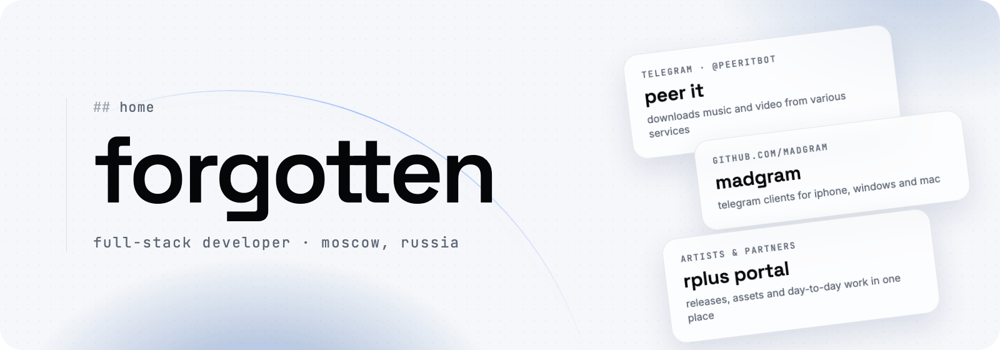

<picture>
<source media="(prefers-color-scheme: dark)" srcset="assets/banner-dark.png">

</picture>

## about

hey! i'm forgotten, a full-stack developer from moscow. i make small tools that work quietly: bots, portals, automation. if i wouldn't use it myself, it doesn't ship

## now

- lead developer at **rplus**
- special administrator at **motion project**, technical administrator there before that

## projects

| project | | made&nbsp;with |
|---|---|---|
| [peer&nbsp;it](https://t.me/peeritbot) | a telegram bot that downloads music and video from various services |  |
| [mad](https://github.com/madgram) | telegram clients for iphone, windows and mac: ghost mode, message filtering and interface customization |  |
| [rplus&nbsp;portal](https://portal.rpluslb.ru) | home for rplus artists and partners: releases, assets and day-to-day work in one place |  |
| [motion&nbsp;support](https://t.me/motion_tech_support_bot) | automated support infrastructure handling 5k+ requests a day |  |
| [share&nbsp;weather](https://t.me/shareweatherbot) | an inline telegram bot for sharing a forecast without leaving the chat |  |
| [log](https://log.thisisforgotten.com) | a minimal tool for sharing text snippets and notes, nothing else on the page |  |

## stack

<b>main</b>

<b>also</b>

<b>infra</b>

